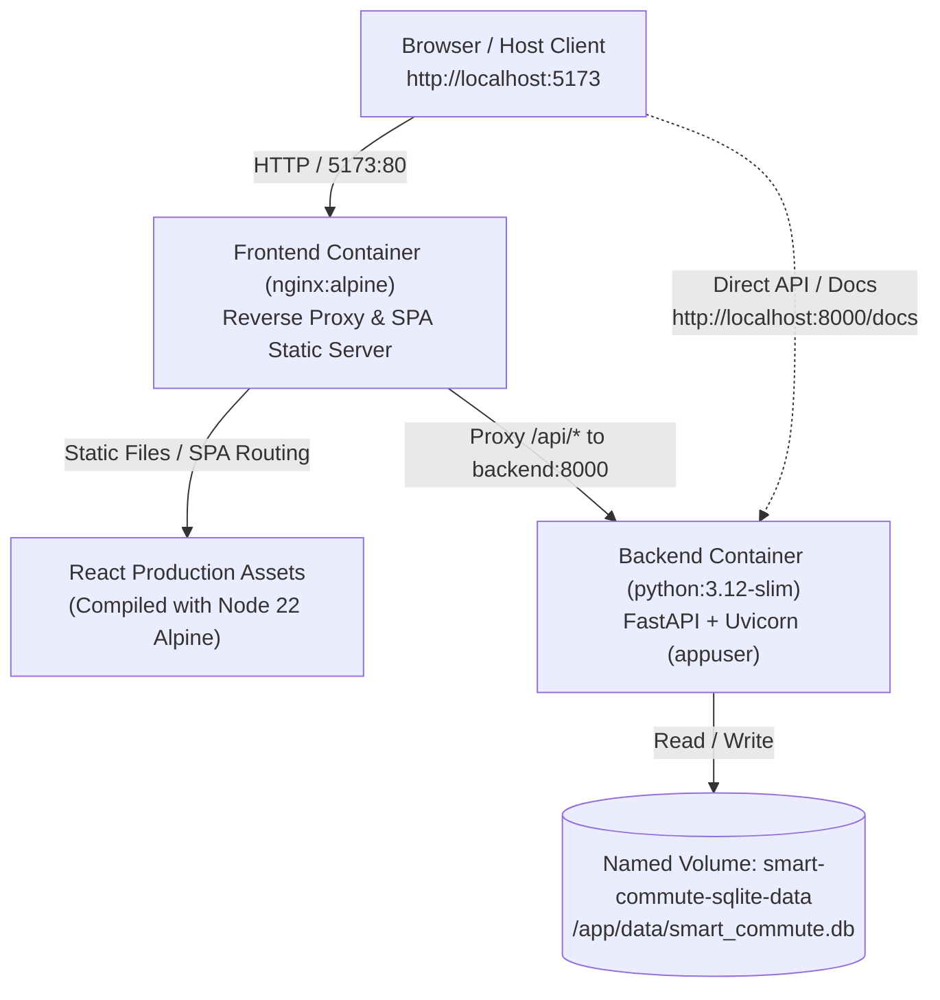

# SmartCommute Docker & Containerization Guide

[English version](#english) | [Wersja polska](#wersja-polska)

---

<a name="english"></a>

## English

This guide provides complete instructions for running, configuring, and inspecting the SmartCommute full-stack application (FastAPI backend + React TypeScript frontend) using Docker and Docker Compose.

### Architecture Overview

SmartCommute is containerized using a clean, multi-container architecture orchestrated with Docker Compose:



#### Key Architecture Principles:

1. **Multi-Stage Builds:**
   - **Backend (`backend/Dockerfile`):** Stage 1 uses `ghcr.io/astral-sh/uv` on `python:3.12-slim` to resolve dependencies with layer caching and compile bytecode. Stage 2 produces a lightweight runtime image running as a non-root system user (`appuser`, UID `10001`).
   - **Frontend (`frontend/Dockerfile`):** Stage 1 uses `node:22-alpine` to compile TypeScript with Vite (`npm ci && npm run build`). Stage 2 serves the bundled static assets using `nginx:alpine` (~25MB).
2. **Reverse Proxy Routing:** Nginx proxies all `/api/*` traffic to `http://backend:8000` via the internal Docker bridge network (`smart-commute-net`). This eliminates CORS friction in production and guarantees seamless browser routing.
3. **Data Persistence:** The embedded SQLite database (`smart_commute.db`) is stored on a dedicated named Docker volume (`smart-commute-sqlite-data`) mounted at `/app/data`.
4. **Healthchecks & Dependency Ordering:** The frontend container waits for the backend service to report healthy via `GET /health` before receiving traffic.

---

### Quick Start (One Command)

From the project root directory, run:

```bash
docker compose up --build
```

To run in detached background mode:

```bash
docker compose up --build -d
```

#### Service URLs:

- **Frontend Web Application:** [http://localhost:5173](http://localhost:5173)
- **FastAPI Interactive Docs (Swagger):** [http://localhost:8000/docs](http://localhost:8000/docs)
- **FastAPI Alternative Docs (ReDoc):** [http://localhost:8000/redoc](http://localhost:8000/redoc)
- **Backend Health Check:** [http://localhost:8000/health](http://localhost:8000/health)

---

### Environment Variables & AI Configuration

The application is **100% zero-config out-of-the-box**. If no LLM API keys are provided, it automatically uses the deterministic heuristic recommendation engine.

To enable live external LLMs (Gemini, OpenAI, or Claude), copy `.env.example` to `.env` or set environment variables in `docker-compose.yml`:

```env
# Optional external LLM API keys
GEMINI_API_KEY=your_gemini_api_key_here
OPENAI_API_KEY=your_openai_api_key_here
ANTHROPIC_API_KEY=your_anthropic_api_key_here

# Optional port overrides (defaults: 5173 for frontend, 8000 for backend)
FRONTEND_PORT=5173
BACKEND_PORT=8000

# Optional CORS origins (comma-separated)
CORS_ORIGINS=http://localhost:5173,http://localhost:80,http://127.0.0.1:5173
```

---

### Volume Management & Data Persistence

1. **Automatic Initial Seed:** On the first run, the backend detects an empty database and automatically populates realistic Kraków commute routes and historical trip logs.
2. **Data Preservation:** Data persists across container restarts:
   ```bash
   # Safe stop (preserves database volume):
   docker compose down

   # Restart (data remains intact):
   docker compose up -d
   ```
3. **Reset Database to Initial Seed:** To wipe the persistent volume and reload fresh default seed data:
   ```bash
   docker compose down -v
   docker compose up --build -d
   ```

---

### Useful Commands Reference

| Action                                | Command                          |
| :------------------------------------ | :------------------------------- |
| **Build & start in foreground**       | `docker compose up --build`      |
| **Start in background (detached)**    | `docker compose up -d`           |
| **Check container status & health**   | `docker compose ps`              |
| **Stream container logs**             | `docker compose logs -f`         |
| **Stream backend logs only**          | `docker compose logs -f backend` |
| **Restart services**                  | `docker compose restart`         |
| **Stop containers (preserve data)**   | `docker compose down`            |
| **Stop and wipe volume (reset data)** | `docker compose down -v`         |
| **Execute bash shell in backend**     | `docker compose exec backend sh` |

---

### Troubleshooting

#### Port Conflict (`5173` or `8000` already in use)

If port `5173` or `8000` is currently occupied by another process on your host:

- Set `FRONTEND_PORT` or `BACKEND_PORT` in your `.env` file:
  ```env
  FRONTEND_PORT=3000
  BACKEND_PORT=8080
  ```
- Or pass them directly:
  ```bash
  FRONTEND_PORT=3000 BACKEND_PORT=8080 docker compose up -d
  ```

#### Permission Errors on SQLite Volume

The backend container runs as non-root user `appuser` (UID `10001`). Docker named volumes automatically initialize with the image directory permissions (`/app/data`). If you mount a local host directory instead of a named volume, ensure the host directory has read/write permissions for UID `10001` or run `chmod 777` on the directory.

#### Healthcheck Timing Out

The backend healthcheck connects via `urllib.request` to `http://localhost:8000/health`. If running on resource-constrained environments, you can adjust `start_period` or `retries` in `docker-compose.yml`.

---

<a name="wersja-polska"></a>

## Wersja polska

Ten przewodnik zawiera kompletne instrukcje uruchomienia, konfiguracji i diagnostyki aplikacji SmartCommute (backend FastAPI + frontend React TypeScript) przy użyciu Dockera i Docker Compose.

### Przegląd architektury

Aplikacja SmartCommute jest w pełni skonteneryzowana przy użyciu architektury wielokontenerowej:

- **Backend (`backend/Dockerfile`):**
  - Budowanie wieloetapowe (Multi-stage build) oparte na `python:3.12-slim` oraz instalatorze `uv` z cache'owaniem warstw zależności.
  - Uruchamianie z uprawnieniami nieuprzywilejowanego użytkownika systemowego (`appuser`, UID `10001`).
  - Dedykowany punkt kontrolny zdrowia kontenera (`GET /health`).
- **Frontend (`frontend/Dockerfile`):**
  - Budowanie wieloetapowe: kompilacja kodu źródłowego TypeScript z użyciem `node:22-alpine` (`npm ci && npm run build`), a następnie serwowanie zoptymalizowanych plików statycznych przez serwer `nginx:alpine`.
  - Konfiguracja `nginx.conf`: obsługa routingu SPA (`try_files $uri $uri/ /index.html`) oraz reverse proxy przekierowujące ruch `/api/*` do usługi backendu (`http://backend:8000`).
- **Orkiestracja (`docker-compose.yml`):**
  - Wewnętrzna sieć mostkowa (`smart-commute-net`).
  - Nazwany wolumen Docker (`smart-commute-sqlite-data`) zapewniający trwałość bazy danych SQLite między restartami kontenerów.
  - Warunkowe uruchamianie frontendu po potwierdzeniu stanu `healthy` backendu.

---

### Szybki start (jedno polecenie)

W głównym katalogu projektu wykonaj polecenie:

```bash
docker compose up --build
```

Uruchomienie w tle (tryb detached):

```bash
docker compose up --build -d
```

#### Dostępne adresy:

- **Aplikacja webowa (Frontend):** [http://localhost:5173](http://localhost:5173)
- **Interaktywna dokumentacja Swagger:** [http://localhost:8000/docs](http://localhost:8000/docs)
- **Alternatywna dokumentacja ReDoc:** [http://localhost:8000/redoc](http://localhost:8000/redoc)
- **Endpoint stanu aplikacji (Healthcheck):** [http://localhost:8000/health](http://localhost:8000/health)

---

### Zmienne środowiskowe i konfiguracja AI

Aplikacja działa w trybie **100% Zero-Config**. Bez podawania kluczy API, silnik rekomendacji automatycznie przełącza się na deterministyczne heurystyki pogodowe.

Jeśli chcesz użyć zewnętrznych modeli językowych (Google Gemini, OpenAI, Claude), utwórz plik `.env` na podstawie `.env.example`:

```env
# Opcjonalne klucze API dostawców AI
GEMINI_API_KEY=twoj_klucz_gemini
OPENAI_API_KEY=twoj_klucz_openai
ANTHROPIC_API_KEY=twoj_klucz_claude

# Opcjonalne porty na hoście
FRONTEND_PORT=5173
BACKEND_PORT=8000

# Opcjonalne reguły CORS
CORS_ORIGINS=http://localhost:5173,http://localhost:80,http://127.0.0.1:5173
```

---

### Zarządzanie wolumenami i persystencja danych

1. **Automatyczne seedowanie:** Przy pierwszym uruchomieniu backend wykrywa pustą bazę SQLite i automatycznie dodaje przykładowe krakowskie trasy oraz historię przejazdów.
2. **Zachowanie danych:** Zatrzymanie kontenerów poleceniem `docker compose down` zachowuje bazę danych w nazwanym wolumenie. Kolejne `docker compose up` wznawia pracę z istniejącymi danymi.
3. **Reset bazy danych:** Aby wyczyścić bazę danych i załadować świeże dane domyślne:
   ```bash
   docker compose down -v
   docker compose up --build -d
   ```

---

### Przydatne polecenia

```bash
# Sprawdzenie statusu i kondycji kontenerów
docker compose ps

# Podgląd logów w czasie rzeczywistym
docker compose logs -f

# Zatrzymanie kontenerów z zachowaniem danych
docker compose down

# Zatrzymanie i usunięcie bazy danych
docker compose down -v
```
